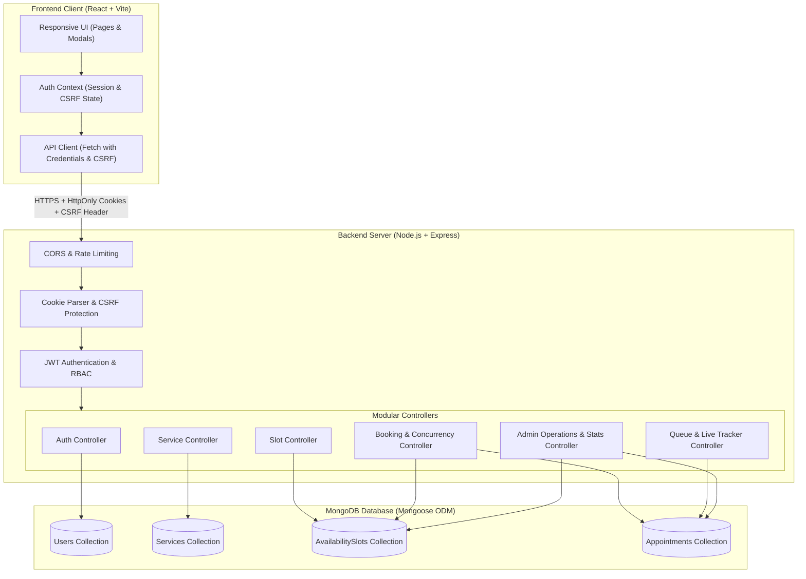
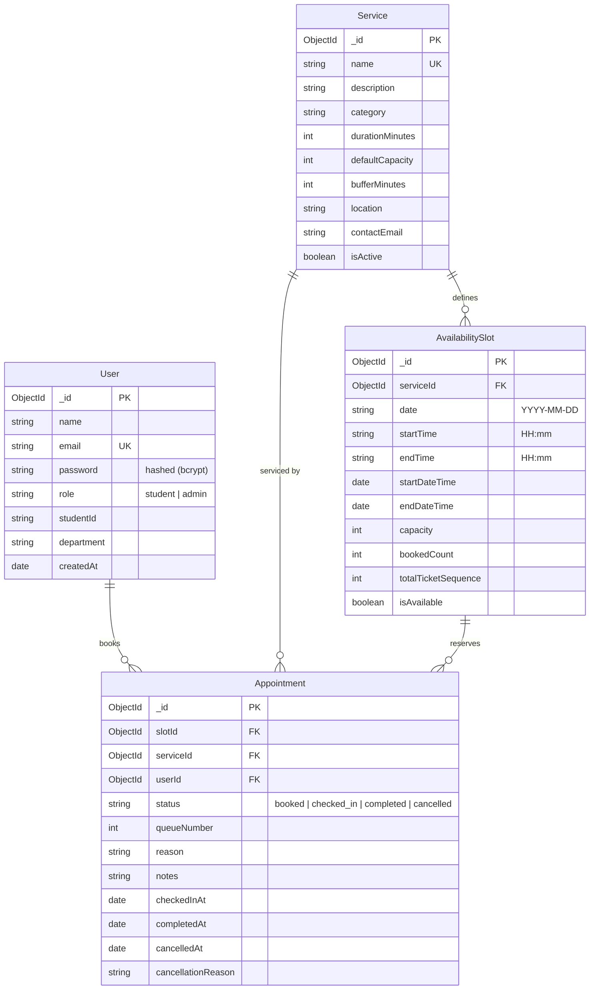
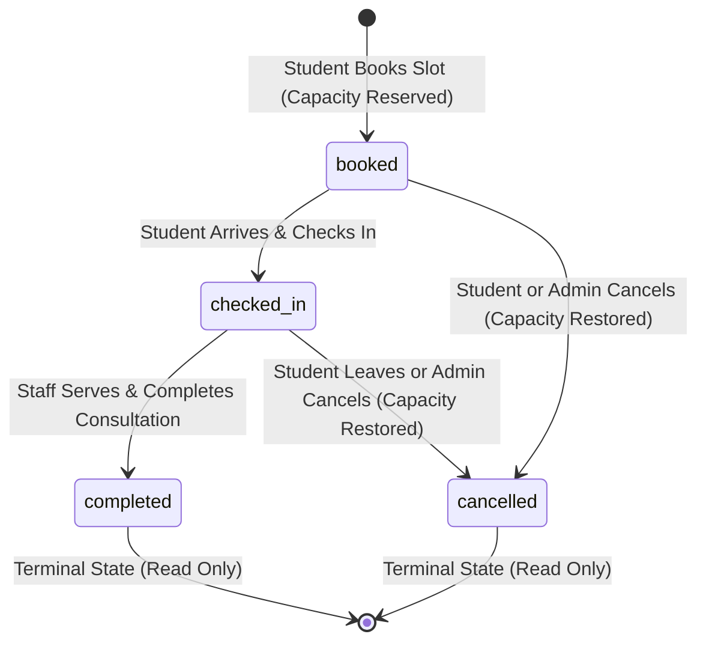

# QueueLess Architecture Documentation

QueueLess is a complete, enterprise-grade appointment booking and real-time queue management system tailored for higher education and campus services (Academic Advising, Financial Aid, Campus Health, Registrar, and Career Services).

---

## 1. High-Level Architecture Overview



---

## 2. Core Architectural Pillars

### 2.1 Technology Stack Selection
- **Frontend**: React 18 with Vite for lightning-fast build performance, native ES modules, and zero-runtime overhead CSS styling.
- **Backend**: Node.js 24 with Express 4 modular routing.
- **Database**: MongoDB 7.0 with Mongoose 8 schema enforcement and compound indexing.
- **Authentication**: Stateless JSON Web Tokens (JWT) stored exclusively in `HttpOnly`, `SameSite=Lax` cookies, preventing XSS-based token theft.
- **CSRF Protection**: Double Submit Cookie pattern (`XSRF-TOKEN` cookie mirrored to `x-csrf-token` header) for all cookie-authenticated state-changing operations (`POST`, `PUT`, `PATCH`, `DELETE`).

---

## 3. Database Schema & Index Design



### Critical Database Indexes
1. **Slot Uniqueness Constraint**:
   ```javascript
   availabilitySlotSchema.index({ serviceId: 1, date: 1, startTime: 1 }, { unique: true });
   ```
   Prevents accidental creation of duplicate slots for the same department at the same time.
2. **Active Booking Fast Lookup**:
   ```javascript
   appointmentSchema.index({ userId: 1, slotId: 1, status: 1 });
   ```
   Prevents duplicate active appointments by the same student for the same slot.
3. **Queue Sorting & Ordering Index**:
   ```javascript
   appointmentSchema.index({ slotId: 1, status: 1, queueNumber: 1 });
   ```
   Ensures \(O(\log N)\) calculation of dynamic positions in line.

---

## 4. Concurrency & Overbooking Prevention Strategy

Overbooking is a critical failure mode in campus queuing applications. When 50 students attempt to reserve 3 remaining spots at the exact same millisecond, traditional `find()` then `save()` patterns cause race conditions.

QueueLess employs an **Atomic Conditional Reservation Strategy** implemented at the database engine level:

```javascript
const reservedSlot = await AvailabilitySlot.findOneAndUpdate(
  {
    _id: slotId,
    isAvailable: true,
    $expr: { $lt: ['$bookedCount', '$capacity'] } // Atomic filter condition
  },
  {
    $inc: { bookedCount: 1, totalTicketSequence: 1 } // Atomic increment
  },
  {
    new: true
  }
);

if (!reservedSlot) {
  // Slot capacity reached or slot unavailable
  return res.status(409).json({ message: 'Slot capacity reached.' });
}
```

### Why this strategy is optimal:
1. **Thread-Safe & Database-Enforced**: MongoDB's single-document atomicity guarantees that even with 100 concurrent requests, exactly \(C\) requests will match the condition `$bookedCount < $capacity` and increment the counter. All remaining \(N - C\) requests evaluate to `null` and return immediate `409 Conflict` responses without acquiring locks or dirty reads.
2. **Compensating Rollback Pattern**: If subsequent appointment document creation fails (e.g., validation error or network abort), a compensating transaction executes `$inc: { bookedCount: -1 }` to restore capacity immediately.
3. **Strictly Monotonic Queue Tickets**: `totalTicketSequence` is atomically incremented alongside `bookedCount`, guaranteeing that concurrent requests receive strictly increasing, distinct queue ticket numbers (`#1`, `#2`, `#3`...) with zero race conditions.
4. **MongoDB Deployment Agnostic**: Works seamlessly across **standalone MongoDB instances**, **replica sets**, and **sharded clusters** without requiring multi-document distributed transaction overhead.

### Multi-Document Transaction Requirements:
For deployments where multi-document transactions across collections are mandated:
- A MongoDB Replica Set or MongoDB Atlas cluster is required (MongoDB does not support multi-document transactions on standalone single-node deployments).
- In such environments, `session.withTransaction(...)` can wrap both slot increment and appointment creation.

---

## 5. Queue Management & State Machine



### Allowed State Transitions
| Current Status | Permitted Next Status | Actor | Side Effects |
| :--- | :--- | :--- | :--- |
| `booked` | `checked_in` | Student / Staff | Sets `checkedInAt = Date.now()` |
| `booked` | `cancelled` | Owner / Staff | Sets `cancelledAt`, restores slot capacity (`$inc: -1`) |
| `checked_in` | `completed` | Staff / Admin | Sets `completedAt`, attaches optional staff notes |
| `checked_in` | `cancelled` | Owner / Staff | Sets `cancelledAt`, restores slot capacity (`$inc: -1`) |
| `completed` | *None* | *None* | Terminal state; modifications rejected (400) |
| `cancelled` | *None* | *None* | Terminal state; modifications rejected (400) |

### Dynamic Queue Position Recalculation
Queue positions are calculated dynamically based on active status records (`booked`, `checked_in`):
$$\text{aheadCount} = \text{Count of active appointments for this slot where } \text{queueNumber} < \text{currentTicketNumber}$$
$$\text{positionInLine} = \text{aheadCount} + 1$$
$$\text{estimatedWaitMinutes} = \text{aheadCount} \times \text{service.durationMinutes}$$

When student #1 cancels:
- The cancellation updates status to `cancelled`.
- When student #2 queries the queue, the count of active appointments ahead drops from 1 to 0.
- Student #2's dynamic position automatically shifts from #2 to **#1 (Next Up!)**, with zero manual queue reindexing required.

---

## 6. Security Architecture

1. **Password Encryption**: Passwords salted and hashed with `bcryptjs` (cost 10). Password field has `select: false` on the User model.
2. **HttpOnly Cookie Authentication**:
   - Name: `jwt`
   - Attributes: `HttpOnly: true`, `SameSite: Lax`, `Secure: (production)`.
   - Prevents client-side script access to session tokens.
3. **Double Submit CSRF Protection**:
   - Non-HttpOnly `XSRF-TOKEN` cookie set on safe GET requests.
   - Frontend API client reads the cookie and sends it via `x-csrf-token` header on mutating requests (`POST`, `PUT`, `PATCH`, `DELETE`).
   - Server validates matching values for cookie-authenticated requests.
4. **Rate Limiting (`express-rate-limit`)**:
   - Auth endpoints: 30 requests / 15 minutes.
   - Booking endpoints: 60 requests / 15 minutes.
   - General API: 300 requests / 15 minutes.
5. **Role-Based Authorization (RBAC)**:
   - Server-enforced middleware `requireRole('admin')` for all administrative routes.
   - Resource-level ownership validation prevents students from modifying or cancelling other students' appointments.
